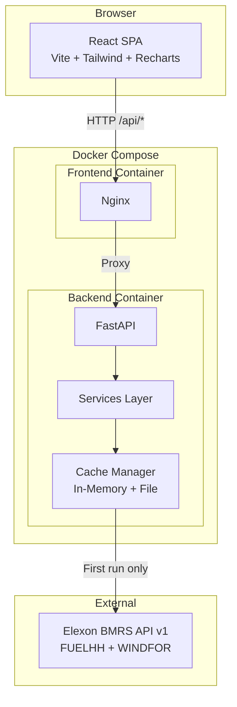

# System Architecture

## 1. Overview

The UK Wind Forecast Accuracy Dashboard is a two-tier web application: a React single-page application (SPA) frontend served via Nginx, and a Python FastAPI backend that fetches, caches, processes, and serves Elexon BMRS wind generation data.



## 2. Component Responsibilities

### 2.1 Frontend (React SPA)

| Component | Responsibility |
|-----------|---------------|
| `App.tsx` | Route definitions (React Router) |
| `AppLayout` | Sidebar navigation, header, responsive shell |
| `pages/*` | Route-level containers that compose hooks and components |
| `hooks/*` | TanStack Query wrappers for each API endpoint |
| `components/dashboard/*` | KPI cards and grid |
| `components/charts/*` | Recharts-based visualisations |
| `lib/api-client.ts` | Typed fetch wrapper with error handling |

### 2.2 Backend (FastAPI)

| Module | Responsibility |
|--------|---------------|
| `app/main.py` | FastAPI application, CORS middleware, lifespan (cache warm-up) |
| `app/config.py` | Environment-based configuration via Pydantic Settings |
| `app/models/elexon.py` | Pydantic models for raw FUELHH and WINDFOR API responses |
| `app/models/domain.py` | Internal domain models (HourlyActual, HourlyForecast, ForecastActualPair) |
| `app/models/responses.py` | API response schemas |
| `app/services/elexon_client.py` | Async HTTP client for Elexon BMRS with retry logic |
| `app/services/data_processor.py` | Half-hourly to hourly aggregation and forecast/actual pairing |
| `app/services/forecast_selector.py` | D-1 cutoff-based forecast run selection |
| `app/services/accuracy_metrics.py` | NumPy-based MAE, RMSE, bias, MAPE, correlation calculation |
| `app/services/cache_manager.py` | Two-tier cache: in-memory dict + JSON files on disk |
| `app/routers/*` | API route handlers |

## 3. Data Flow

```
1. Startup (lifespan):
   Cache Manager checks disk for cached JSON files
   ├── Found → Load into memory (no API calls)
   └── Missing → Fetch from Elexon API → Save to disk + memory

2. Processing (during cache warm-up):
   FUELHH records → aggregate_fuelhh_to_hourly() → HourlyActual[]
   WINDFOR records → select_day_ahead_forecast() → HourlyForecast[] per date
   HourlyForecast[] + HourlyActual[] → pair_forecast_actual() → ForecastActualPair[]

3. Request handling:
   Frontend → GET /api/dashboard/kpis
   → Router reads from CacheManager (in-memory)
   → Calls calculate_metrics() on cached pairs
   → Returns DashboardKPIs JSON
```

## 4. Caching Strategy

**Why:** January 2026 data is historical — it will never change. After one successful fetch, no further API calls are needed.

**Two tiers:**

1. **In-memory dict** — Keyed by date. Fastest access. Populated during lifespan startup.
2. **File-based JSON** — One file per dataset per date in `CACHE_DIR/`. Survives container restarts.

**Warm-up sequence:**

1. Check for `cache/fuelhh.json` on disk.
2. If present, load into memory. If not, fetch from Elexon and save.
3. For each of 31 delivery dates, check for `cache/windfor_2026-01-DD.json`.
4. Fetch missing dates from Elexon in batches of 5 concurrent requests.
5. Run all processing (aggregation, selection, pairing) and store results in memory.

**Result:** After first startup, subsequent startups complete in < 1 second with zero network calls.

## 5. Deployment Architecture

### Local (Docker Compose)

```
docker-compose.yml
├── backend (python:3.12-slim, uvicorn, port 8000)
│   └── volume: ./cache → /app/cache
└── frontend (node:22-alpine build → nginx:alpine, port 3000)
    └── nginx proxies /api/* to backend:8000
```

### Production

| Service | Platform | Notes |
|---------|----------|-------|
| Frontend | Vercel | Static files from `frontend/dist`, rewrites `/api/*` to backend |
| Backend | Railway or Render | Docker-based, persistent volume for cache |

## 6. Key Architecture Decisions

| Decision | Rationale | Alternatives Considered |
|----------|-----------|------------------------|
| In-memory cache (no database) | Historical data doesn't change; 31 days × 24 hours fits easily in memory | SQLite, PostgreSQL — unnecessary complexity |
| FastAPI (not Flask/Django) | Async support for parallel Elexon API calls; automatic OpenAPI docs; Pydantic integration | Flask (no native async), Django (too heavy) |
| Recharts (not D3) | React-native, declarative API, good TypeScript support; faster to implement | D3 (more flexible but much more code), Chart.js (less React-native) |
| TanStack Query (not bare fetch) | Automatic caching, deduplication, loading/error states | SWR (similar), manual useState/useEffect (more boilerplate) |
| Tailwind CSS v4 (not v3) | CSS-first configuration, no config file needed, current stable version | Tailwind v3 (legacy config), CSS modules (more verbose) |
| Hourly aggregation (not HH duplication) | Averaging is the standard approach; duplicating forecast values would overcount | Duplicate forecast to both HH slots (misleading); interpolate (no data to interpolate from) |
